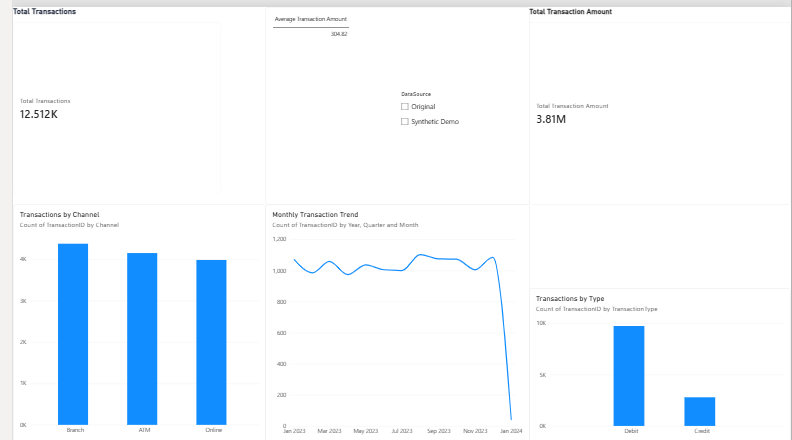
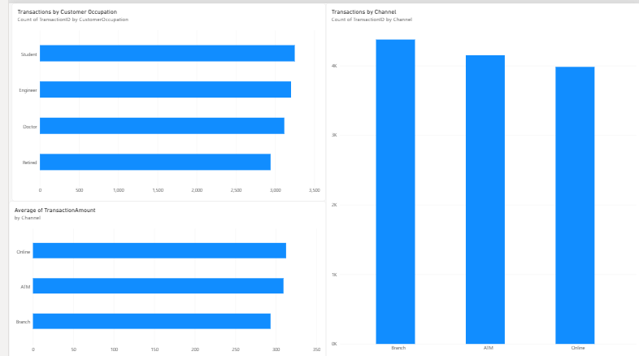
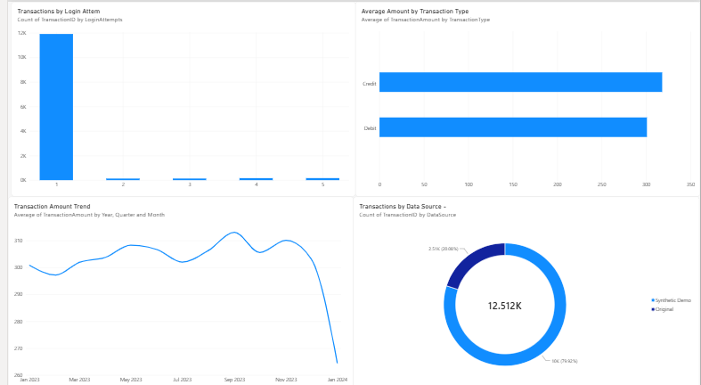
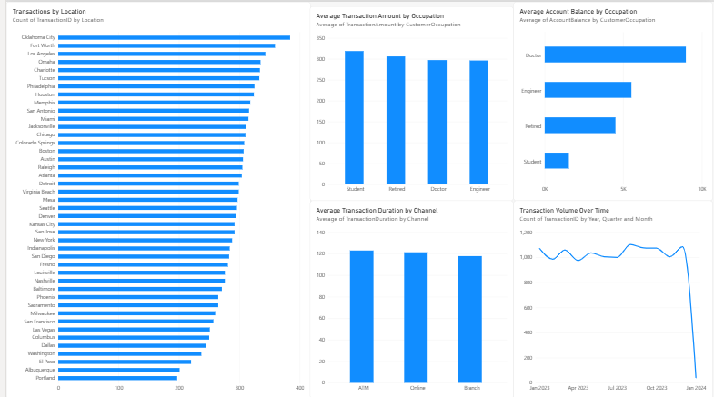

# Banking Transaction Analytics

## Project Overview

This project analyzes banking transaction data using Python, SQL, and Power BI to explore transaction patterns, compare banking channels, and generate business insights through interactive dashboards.

## Objectives

- Analyze debit and credit transaction patterns.
- Compare transaction amounts across banking channels.
- Understand transaction activity across customer occupations.
- Identify locations with high transaction volumes.
- Explore transaction behavior by login attempts.
- Analyze transaction duration and account balance patterns.
- Compare original records with simulated demo data.

## Tools & Technologies

- **Python:** Data analysis and data cleaning
- **Pandas & NumPy:** Data manipulation
- **Matplotlib & Seaborn:** Data visualization
- **SQL (SQLite):** Data querying and aggregation
- **Power BI:** Interactive dashboard development

## Dataset

The original dataset contains **2,512 banking transaction records and 16 columns**, including transaction amount, transaction type, channel, location, customer occupation, login attempts, and account balance.

The project also uses a simulated demo dataset for dashboard development and testing. Any combined-data results include simulated records where applicable.

## Key Insights

- Original transaction records analyzed: 2,512
- Total transaction amount in the original dataset: 747,555.57 (currency not verified)
- Average transaction amount in the original dataset: 297.59
- Debit transactions: 1,944
- Credit transactions: 568
- ATM transactions have an average transaction amount of approximately 307.72.
- Student transactions have an average transaction amount of approximately 313.22.

*Note: These statistics refer to the original dataset unless explicitly stated otherwise.*

## Power BI Dashboard

The Power BI report contains five pages:

1. **Banking Dashboard** — Transaction summary and overview charts.
2. **Executive Overview** — Key metrics, monthly transaction trend, transaction type, and channel analysis.
3. **Customer & Channel Intelligence** — Customer occupation and banking channel comparisons.
4. **Transaction Risk & Anomalies** — Login attempts, transaction amounts, trends, and data-source comparison.
5. **Transaction Insights** — Location, occupation, transaction duration, account balance, and transaction volume analysis.

### Dashboard Screenshots

#### 1. Banking Dashboard


#### 2. Executive Overview


#### 3. Customer & Channel Intelligence


#### 4. Transaction Risk & Anomalies


#### 5. Transaction Insights


## Project Structure

```text
Banking-Transaction-Analytics/
├── data/
├── notebooks/
├── sql/
│   └── banking_analysis.sql
├── visuals/
│   ├── banking_dashboard.png
│   ├── executive_overview.png
│   ├── customer_channel_intelligence.png
│   ├── transaction_risk_anomalies.png
│   └── transaction_insights.png
├── reports/
├── import_to_sqlite.py
├── README.md
└── Banking_Transaction_Analytics.pbix
```

## Disclaimer

This project is for educational and analytical purposes. The demo dataset contains simulated records and must not be interpreted as real banking activity. Login attempts alone do not establish fraudulent activity. The currency of transaction amounts has not been independently verified.

## Author

**Banking Transaction Analytics Project**  
Data Analytics | Python • SQL • Power BI
