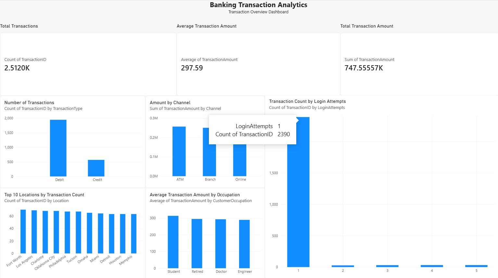

# Banking Transaction Analytics

## Project Overview

This project analyzes banking transaction data using Python, SQL, and Power BI to identify transaction patterns and generate useful business insights.

## Objectives

* Analyze debit and credit transaction patterns.
* Compare transaction amounts across banking channels.
* Understand transaction activity across customer occupations.
* Identify locations with high transaction volumes.
* Explore transaction behavior by login attempts.

## Tools & Technologies

* **Python:** Data analysis and data cleaning
* **Pandas & NumPy:** Data manipulation
* **Matplotlib & Seaborn:** Data visualization
* **SQL (SQLite):** Data querying and aggregation
* **Power BI:** Interactive dashboard development

## Dataset

The dataset contains 2,512 banking transaction records and 16 columns, including transaction amount, transaction type, channel, location, customer occupation, login attempts, and account balance.

## Key Insights

* Total transactions analyzed: 2,512
* Total transaction amount: 747,555.57 (dataset currency not verified)
* Average transaction amount: 297.59
* Debit transactions: 1,944
* Credit transactions: 568
* ATM transactions have an average transaction amount of approximately 307.72.
* Student transactions have an average transaction amount of approximately 313.22.

## Project Structure

```text
Banking-Transaction-Analytics/
├── data/
├── notebooks/
├── sql/
│   └── banking_analysis.sql
├── visuals/
├── reports/
├── import_to_sqlite.py
├── banking.db
└── README.md
```

## Dashboard

The Power BI dashboard includes transaction type, transaction amount by channel, average amount by occupation, top locations by transaction count, and login attempts analysis.



## Disclaimer

This project is for educational and analytical purposes. Login attempts alone do not establish fraudulent activity.

## Author

Data Analytics Project | Python • SQL • Power BI
